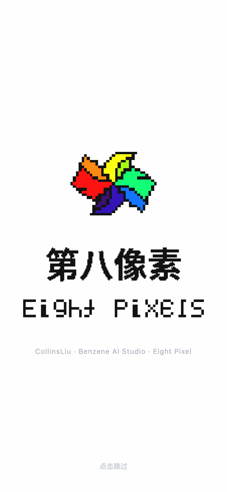
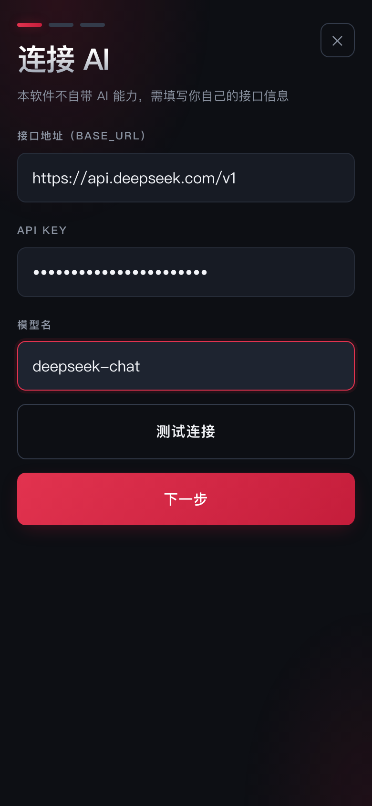
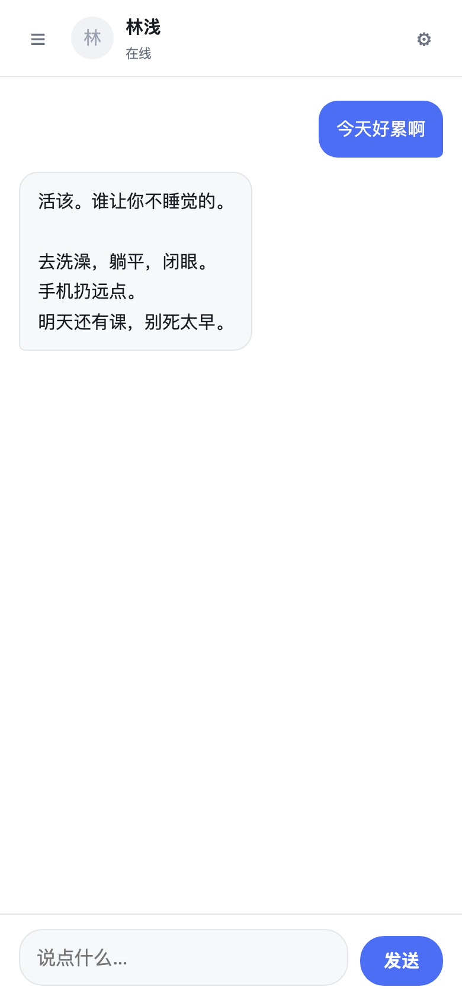
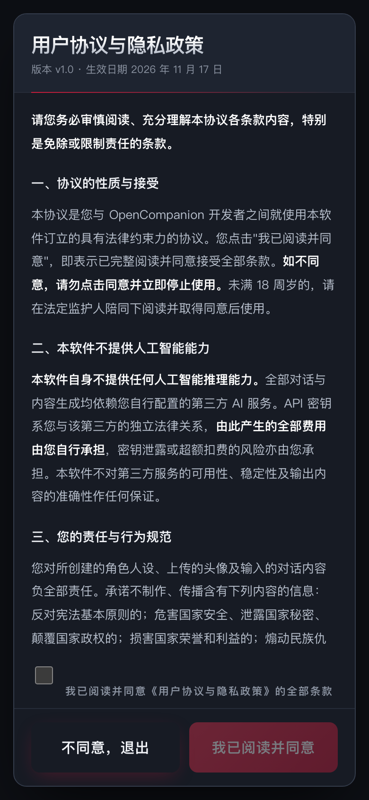

<div align="center">


# OpenCompanion

**一个可以完全自己定义的 AI 伴侣**

填上你自己的 API，用一句话描述想要的角色，AI 帮你把设定打磨成完整人设，然后就可以聊天了。

安卓离线 App · 数据全部留在本机

[](LICENSE)
[](#安装)
[](#)

[Benzene AI Studio](https://space.bilibili.com/1968400182) · Eight Pixel · [@CollinsLiu615](https://github.com/CollinsLiu615)

</div>

---

## 它是什么

市面上大多数 AI 伴侣产品，人设是平台定好的，你只能挑一个。

OpenCompanion 反过来：**人设由你写，AI 由你接，数据存在你自己的设备上。**

- 🔌 **不绑定厂商** —— 任何 OpenAI 兼容接口都能用（OpenAI / DeepSeek / Moonshot / 智谱 / 通义 / 本地 Ollama …）
- 🎭 **人设可打磨** —— 写一句话，AI 扩写成带示例台词的完整人设，之后随时可改
- 💾 **本地优先** —— 无账号、无云端、无埋点，删掉 App 数据就没了
- 🔔 **定时问候** —— 到点收到它的消息，可选由 AI 用角色语气生成
- 👥 **多角色** —— 想养几个养几个，各自独立设定与记忆

## 截图

<div align="center">
<table>
<tr>
<td></td>
<td></td>
<td></td>
<td></td>
</tr>
<tr>
<td align="center">启动动画</td>
<td align="center">三步创建</td>
<td align="center">对话</td>
<td align="center">设置</td>
</tr>
</table>
</div>

---

## 安装

### 安卓 App（完全离线）

1. 到 [Releases](../../releases) 下载最新 `OpenCompanion.apk`
2. 传到手机安装（需允许「安装未知来源应用」）

首次启动需授予通知、相册、后台运行权限，用于定时问候与选择头像。

## 使用

### 1️⃣ 配置 API

填三项：接口地址、API Key、模型名。

| 常见服务商 | 接口地址 | 模型名示例 |
| :--- | :--- | :--- |
| OpenAI | `https://api.openai.com/v1` | `gpt-4o-mini` |
| DeepSeek | `https://api.deepseek.com/v1` | `deepseek-chat` |
| Moonshot | `https://api.moonshot.cn/v1` | `moonshot-v1-8k` |
| 智谱 GLM | `https://open.bigmodel.cn/api/paas/v4` | `glm-4-flash` |
| 通义千问 | `https://dashscope.aliyuncs.com/compatible-mode/v1` | `qwen-plus` |
| 本地 Ollama | `http://localhost:11434/v1` | `qwen2.5` |

> 本软件不自带 AI 能力，费用由你的服务商收取。

### 2️⃣ 描述人设

写一句大白话，比如：

> 嘴硬心软的女大学生，会吐槽我但很关心我，说话简短带点毒舌

点「让 AI 写完整人设」，约 30 秒后生成一份包含身份、性格、说话风格（带 3 句示例台词）、相处方式、边界与禁区的完整文档。

### 3️⃣ 修改、保存、开聊

生成结果是**可直接编辑的文本框**，改到满意为止。之后可随时在设置里继续改。

### 日常使用

| 位置 | 功能 |
| :--- | :--- |
| 左上角 ☰ | 人物列表，切换角色 / 新建 |
| 右上角 ⚙ | 设置：改人设、换头像、定时问候、导出对话、清除记录、删除角色、关于、注销 |

---

## 自己构建

```bash
cd android
./make-keystore.sh    # 首次构建：生成签名证书
./build.sh            # 打包
```

需要 **JDK 21** 与 **Android SDK**（build-tools 34+）。

> ⚠️ 必须使用 build-tools **36.1.0 或更新**。
> 34.0.0 版 `d8` 处理匿名内部类时会崩：
> `NullPointerException: Cannot invoke "String.length()" because "<parameter1>" is null`

> ⚠️ 签名证书一旦丢失，已安装用户将**永远无法升级**（签名不一致系统会拒绝覆盖）。
> 请务必备份 `android/signing/release.keystore`。

## 项目结构

```
OpenCompanion/
├── android/                  安卓 App（完整离线）
│   ├── app/src/              Java：WebView 壳 + 原生网络桥 + 闹钟 + 加密存储
│   ├── app/res/              图标与资源
│   ├── assets/               离线界面（HTML/JS）
│   ├── build.sh              无 Gradle 打包脚本
│   └── make-keystore.sh      生成签名证书
├── docs/
│   ├── 用户协议.md            协议全文
│   ├── 快速上手.md            新手引导
│   └── screenshots/          截图
└── assets/brand/             品牌原始图
```

---

## 安全与隐私

| | |
| :--- | :--- |
| **无埋点** | 无任何统计 SDK |
| **无自有服务器** | 请求只发往你自己填的 `base_url` |
| **加密存储** | API Key 与人设经 Android Keystore（AES-256-GCM）加密，密钥不可导出 |
| **禁止备份导出** | `allowBackup=false` |
| **HTTPS 强制** | 默认禁明文，仅放行 localhost 供本地服务使用 |
| **最小权限** | 9 项，无定位 / 通讯录 / 短信 / 摄像头 |

完整说明（含签名指纹、已知局限）见 [SECURITY.md](SECURITY.md)。

> **免责**：本软件不提供 AI 能力，费用与合规责任由使用者承担。
> AI 生成内容不代表开发者观点。请勿未经授权使用真实人物创建角色。

---

## 贡献

欢迎 Issue 与 PR。提交前请确保：

- 不引入任何埋点或统计 SDK
- 不引入硬编码的服务器地址
- 新增权限需在 PR 中说明用途

## 许可

[MIT](LICENSE) · 人设内容归创建者所有
